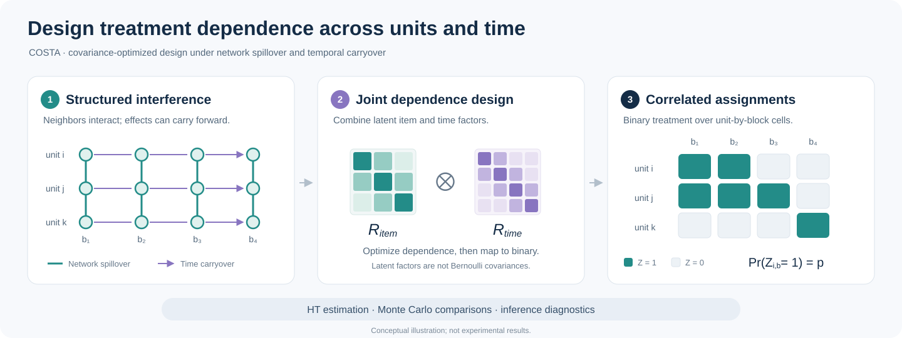
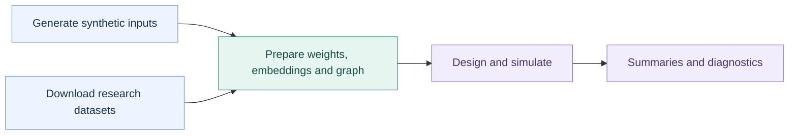

# COSTA

**COSTA: Covariance-Optimized Design and Causal Inference under Network-Temporal Interference**

[](https://arxiv.org/abs/2609.02032)
[](#environment-setup)
[](pyproject.toml)
[](#raw-data-preparation)

Paper authors: **Qianyi Chen**, **Bo Li**, **Yongli Qin**, and **Jinyong Ma**.

[Read the paper](https://arxiv.org/abs/2609.02032) · [Cite this work](#citation)

This repository contains the simulation and design code used for the COSTA paper. COSTA designs correlated treatment assignments over unit-time cells to reduce design-induced bias under network spillover and temporal carryover. The code supports independent Bernoulli randomization, RBSD-style balanced switchbacks, cluster randomization, static graph optimized covariance design, COSTA, and COSTA-IC.

[Overview](#overview) · [Quick start](#environment-setup) · [Datasets](#raw-data-preparation) · [Reproduction guide](#reproducing-selected-paper-results) · [Code map](#repository-structure)

## Overview



*Conceptual illustration, not experimental results. The Kronecker factors describe latent Gaussian correlation; thresholding produces Bernoulli assignments with the requested marginal probability.*

| Joint design | Scalable sampling | Inference diagnostics |
| --- | --- | --- |
| Account for spillover across units and carryover across time in a regularized bias–variance proxy. | Use item and time factors to sample correlated assignments without materializing a full unit-time covariance matrix. | Compare Monte Carlo estimates, variance methods, and coverage under the specified dependence and centering conditions. |

> [!NOTE]
> **Start with synthetic data.** The [smoke test](#quick-smoke-test) generates its own inputs; no download or account is needed. Research datasets and generated outputs remain local. MovieLens 10M requires separate permission for redistribution—see [data preparation](#raw-data-preparation).

The repository is prepared as a public release. Download the research datasets from their providers, then regenerate `data/processed/` locally. Use `scripts/build_release.py` to create a data-free distribution from a working checkout.

## Environment setup

Python 3.10 or newer is recommended.

```bash
python -m venv .venv
source .venv/bin/activate
python -m pip install --upgrade pip
python -m pip install -e '.[dev,leiden]'
```

If `leidenalg` is difficult to install on your platform, use:

```bash
python -m pip install -e '.[dev]'
```

The cluster baseline will then fall back to NetworkX Louvain unless `--cluster-fallback none` is specified.

## Quick smoke test

The following commands generate a small synthetic dataset, prepare it, run a short COSTA simulation, and run unit tests. No bundled dataset, account, or download is needed for this check.

```bash
python scripts/make_sample_data.py
python scripts/prepare_data.py --config configs/sample.yaml
python scripts/run_simulation.py --config configs/sample_debug.yaml
python -m pytest -q
```

This smoke test writes generated files to `data/sample/`, `data/processed/`, and `outputs/sim/`. For research settings, continue with the dataset download and preparation steps below.

## Raw data preparation



| Input | How to obtain it | Preparation profile |
| --- | --- | --- |
| Synthetic smoke data | `python scripts/make_sample_data.py` | [`sample.yaml`](configs/sample.yaml) |
| MovieLens 10M | Official GroupLens download; no Kaggle account | [`movielens10m_10k.yaml`](configs/movielens10m_10k.yaml) |
| RetailRocket | Kaggle download using your own credentials | [`retailrocket_10k.yaml`](configs/retailrocket_10k.yaml) |

### MovieLens 10M: download from GroupLens

The [MovieLens 10M usage license](https://files.grouplens.org/datasets/movielens/ml-10m-README.html) states: **"The user may not redistribute the data without separate permission."** Research use also requires acknowledgment; commercial use requires separate permission, and endorsement must not be implied. The [official dataset page](https://grouplens.org/datasets/movielens/10m/) provides the archive and the governing terms. Review those terms before downloading or using the data.

Download directly from GroupLens (approximately 63 MB compressed; requires Bash, `curl`, and `unzip`; no Kaggle account is needed):

```bash
bash scripts/download_movielens10m.sh
# Optional custom destination:
bash scripts/download_movielens10m.sh /path/to/local/ml-10m
```

The default destination is `data/raw/ml-10m/`. The downloader preserves the upstream package and its README/license. The loader searches nested folders such as `ml-10M100K/` and also supports existing `ratings.dat` or `ratings.csv` files. For a custom destination, pass `--raw-dir /path/to/local/ml-10m` to the preparation command below. Existing files are protected; follow the script's message if a destination is incomplete.

If `curl` reports a certificate error, check your system clock and trusted CA setup or wait for the provider to correct its certificate. Do not disable TLS verification. You can also download from the official page in a browser that successfully verifies the connection, then extract the archive into the same local destination.

The old helper used a third-party Kaggle mirror. The default helper now uses the original provider. This packaging change does not establish byte-for-byte equivalence with any previously downloaded mirror or rerun past paper results. `download_movielens_small.sh` downloads a **different**, optional development dataset and is not a replacement for the 10M benchmark. Different MovieLens releases have different licenses; do not apply the small dataset's redistribution terms to 10M.

Required dataset citation:

> F. Maxwell Harper and Joseph A. Konstan. 2015. *The MovieLens Datasets: History and Context*. ACM Transactions on Interactive Intelligent Systems 5(4), Article 19. [DOI: 10.1145/2827872](https://doi.org/10.1145/2827872).

### RetailRocket: obtain from the provider

Obtain the data from the [RetailRocket dataset page](https://www.kaggle.com/datasets/retailrocket/ecommerce-dataset), review its terms, and configure the Kaggle CLI with your own credentials outside this repository. The helper prints setup instructions:

```bash
bash scripts/download_retailrocket.sh
# After configuring Kaggle:
kaggle datasets download -d retailrocket/ecommerce-dataset -p data/raw/retailrocket --unzip
```

Never commit a Kaggle token or credential file. RetailRocket data are also excluded from both distributions.

### Local preparation and distribution boundary

The expected local inputs are:

```text
data/raw/retailrocket/events.csv      # or events.csv.zip
data/raw/ml-10m/ratings.dat           # or ratings.csv
```

The loaders also search nested Kaggle/MovieLens folders under these directories. Empty directories, `.gitkeep`, and download instructions are not dataset records and can be tracked. Raw `.dat`/`.csv` files, downloaded ZIP files, and processed interaction records must remain local. As a conservative distribution policy, this project also excludes derived embeddings, ID maps, graphs, all processed arrays, generated synthetic files, and experiment outputs; that policy is not a claim that the license explicitly prohibits every possible aggregate statistic.

Prepare the two default datasets used in the paper:

```bash
python scripts/prepare_data.py --config configs/retailrocket_10k.yaml
python scripts/prepare_data.py --config configs/movielens10m_10k.yaml
```

This creates:

```text
data/processed/retailrocket_top10k_b4_k10/
data/processed/movielens_top10k_b4_k10/
```

Each processed folder contains mapped interactions, item-block traffic weights, item popularity, item embeddings, and a sparse top-K competition graph.

`.gitignore` prevents ordinary staging of local data, but it does not remove files already committed and is not a filter for Finder/ZIP uploads. Use the release builder described below for file uploads. If dataset files were ever published on another branch, tag, release, Git LFS store, or fork, removing them from the current tree alone does not remove those copies.

## Reproducing selected paper results

All commands below should be run from the repository root. Add `--no-progress` for quieter terminal output. Add `--no-plot` when you want CSV outputs only.

| What you want to reproduce | Start here |
| --- | --- |
| Main simulation comparisons | [Default-setting RMSE tables and Figure 1](#default-setting-rmse-tables-and-figure-1) |
| Sensitivity to scale and design settings | [Item count, top-K, treatment share, and horizon](#setting-ablations-item-count-top-k-sparsity-treatment-share-and-block-horizon) |
| COSTA parameterization choices | [Kronecker dimension](#costa-kronecker-dimension-ablation) and [cluster reduction](#clusterkronecker-reduction-ablation) |
| COSTA-IC components | [Lambda variants](#costa-ic-lambda-ablation) and [balance/switching ablations](#costa-ic-balance-and-switching-component-ablation) |
| Variance and coverage diagnostics | [HAC and design-aware correction](#inference-diagnostics-hac-design-aware-correction-and-bias-aware-inflation) |
| Supplementary inference validation | [Eight-block preparation and revised26 runner](#supplementary-inference-validation-revised26) |

### Default-setting RMSE tables and Figure 1

The default models remain `linear,nonlinear,demand`. For an optional second-hop
ablation, select `--models interaction_second_hop` (alias `second_hop`) and use
a separate `--out-dir`. This independent model uses `--second-hop-scale` and
`--interaction-scale`, model seed ID 4, and the `interaction_second_hop` output
label. Earlier versions of `run_simulation.py` silently replaced this selection
with `demand`; those runs do not constitute second-hop results and should not be
relabelled. Existing default-model results are unchanged.

<details>
<summary><strong>Run the main comparisons for RetailRocket and MovieLens</strong></summary>

RetailRocket:

```bash
python scripts/run_simulation.py \
  --config configs/retailrocket_10k.yaml \
  --designs independent,rbsd_approx,cluster_leiden,static_graph_ocd,COSTA,COSTA_IC_lam1 \
  --models linear,nonlinear,demand \
  --p 0.5 --mc 500 --steps 400
```

MovieLens:

```bash
python scripts/run_simulation.py \
  --config configs/movielens10m_10k.yaml \
  --designs independent,rbsd_approx,cluster_leiden,static_graph_ocd,COSTA,COSTA_IC_lam1 \
  --models linear,nonlinear,demand \
  --p 0.5 --mc 500 --steps 400
```

</details>

### Setting ablations: item count, top-K sparsity, treatment share, and block horizon

<details>
<summary><strong>Prepare the grid and choose an ablation family</strong></summary>

First prepare every processed dataset required by the grid:

```bash
python scripts/prepare_ablation_grid.py --grid configs/ablation_grid.yaml --all
```

Then run the ablations:

```bash
python scripts/run_ablation_grid.py --grid configs/ablation_grid.yaml --all
```

To run only one family:

```bash
python scripts/prepare_ablation_grid.py --grid configs/ablation_grid.yaml --only item_count
python scripts/run_ablation_grid.py --grid configs/ablation_grid.yaml --only item_count

python scripts/prepare_ablation_grid.py --grid configs/ablation_grid.yaml --only top_k
python scripts/run_ablation_grid.py --grid configs/ablation_grid.yaml --only top_k

python scripts/prepare_ablation_grid.py --grid configs/ablation_grid.yaml --only p
python scripts/run_ablation_grid.py --grid configs/ablation_grid.yaml --only p

python scripts/prepare_ablation_grid.py --grid configs/ablation_grid.yaml --only B
python scripts/run_ablation_grid.py --grid configs/ablation_grid.yaml --only B
```

</details>

### COSTA Kronecker dimension ablation

<details>
<summary><strong>Run the Kronecker dimension sweep</strong></summary>

```bash
python scripts/prepare_ablation_grid.py --grid configs/ablation_grid.yaml --only d_item
python scripts/run_ablation_grid.py --grid configs/ablation_grid.yaml --only d_item
```

</details>

### Cluster/Kronecker reduction ablation

<details>
<summary><strong>Append cluster and Kronecker reduction variants</strong></summary>

After the main simulation folders exist, append the extra COSTA variants:

```bash
python scripts/run_extra_cluster_costa_grid.py --dataset all
```

This adds `COSTA_cluster_no_kro` and `COSTA_cluster_kro` variants to completed simulation folders.

</details>

### COSTA-IC lambda ablation

<details>
<summary><strong>Append COSTA-IC lambda variants</strong></summary>

After the main simulation folders exist, append extra COSTA-IC variants:

```bash
python scripts/run_extra_costa_ic_grid.py --dataset all
```

The default grid appends `COSTA_IC_lam0.2`, `COSTA_IC_lam1`, and `COSTA_IC_lam5`.

</details>

### Inference diagnostics: HAC, design-aware correction, and bias-aware inflation

<details>
<summary><strong>Run variance and inference diagnostics for both datasets</strong></summary>

RetailRocket:

```bash
python scripts/run_clt_designaware_variance.py \
  --config configs/retailrocket_10k.yaml \
  --n-items 10000 --n-blocks 8 --top-k 10 \
  --p-values 0.5 \
  --models linear,nonlinear,demand \
  --mc 500 --design-mc 200 --steps 400
```

MovieLens:

```bash
python scripts/run_clt_designaware_variance.py \
  --config configs/movielens10m_10k.yaml \
  --n-items 10000 --n-blocks 8 --top-k 10 \
  --p-values 0.5 \
  --models linear,nonlinear,demand \
  --mc 500 --design-mc 200 --steps 400
```

</details>

### COSTA-IC balance and switching component ablation

<details>
<summary><strong>Run the COSTA-IC component ablations</strong></summary>

RetailRocket:

```bash
python scripts/run_clt_ic_component_ablation.py \
  --config configs/retailrocket_10k.yaml \
  --n-items 10000 --n-blocks 8 --top-k 10 \
  --p-values 0.5 \
  --models linear,nonlinear,demand \
  --mc 500 --steps 400
```

MovieLens:

```bash
python scripts/run_clt_ic_component_ablation.py \
  --config configs/movielens10m_10k.yaml \
  --n-items 10000 --n-blocks 8 --top-k 10 \
  --p-values 0.5 \
  --models linear,nonlinear,demand \
  --mc 500 --steps 400
```

</details>

### Supplementary inference validation (`revised26`)

<details>
<summary><strong>Prepare eight-block inputs and run supplementary inference</strong></summary>

The supplementary runner requires separate **eight-block** prepared datasets; the default profiles above prepare four blocks. Prepare its inputs first:

```bash
python scripts/prepare_data.py --config configs/retailrocket_10k.yaml --n-blocks 8
python scripts/prepare_data.py --config configs/movielens10m_10k.yaml --n-blocks 8
bash scripts/run_required_inference_revised26.sh
```

`configs/inference_revised26.yaml` documents the reference specification; the shell runner supplies the actual inference options. It runs 1,000 evaluation draws with separate mean and tail calibration budgets of 500 each. These are computationally substantial reproduction commands, not steps required to inspect the code or run unit tests.

To create its tables and figures from completed outputs in a new local directory:

```bash
python scripts/plot_inference_validation_revised26.py \
  --input-root outputs/inference_revised26 \
  --manuscript-dir outputs/inference_presentation \
  --p 0.5 --model linear --internal-designs COSTA,COSTA_IC_lam1
```

The plotter creates `tables/` and `figures/` under that destination; an external manuscript checkout is not required.

</details>

## Reproducing the full ablation suite

<details>
<summary><strong>Run the complete suite (computationally heavy)</strong></summary>

The full suite is computationally heavy. It prepares many processed folders and runs Monte Carlo simulations for both datasets across all ablation families.

```bash
# 1. Prepare all data variants.
python scripts/prepare_ablation_grid.py --grid configs/ablation_grid.yaml --all

# 2. Run all main ablation simulations.
python scripts/run_ablation_grid.py --grid configs/ablation_grid.yaml --all

# 3. Append focused COSTA reduction and COSTA-IC lambda variants.
python scripts/run_extra_cluster_costa_grid.py --dataset all
python scripts/run_extra_costa_ic_grid.py --dataset all

# 4. Run inference and COSTA-IC component diagnostics for both datasets.
python scripts/run_clt_designaware_variance.py --config configs/retailrocket_10k.yaml --n-items 10000 --n-blocks 8 --top-k 10 --p-values 0.5 --models linear,nonlinear,demand --mc 500 --design-mc 200 --steps 400
python scripts/run_clt_designaware_variance.py --config configs/movielens10m_10k.yaml --n-items 10000 --n-blocks 8 --top-k 10 --p-values 0.5 --models linear,nonlinear,demand --mc 500 --design-mc 200 --steps 400
python scripts/run_clt_ic_component_ablation.py --config configs/retailrocket_10k.yaml --n-items 10000 --n-blocks 8 --top-k 10 --p-values 0.5 --models linear,nonlinear,demand --mc 500 --steps 400
python scripts/run_clt_ic_component_ablation.py --config configs/movielens10m_10k.yaml --n-items 10000 --n-blocks 8 --top-k 10 --p-values 0.5 --models linear,nonlinear,demand --mc 500 --steps 400
```

</details>

## Plotting generated results

The plotting scripts summarize outputs from the inference runs:

```bash
python scripts/plot_clt_validation.py --input-root outputs/clt --out-dir outputs/figures/clt
python scripts/plot_clt_designaware_variance.py --input-root outputs/clt_designaware --out-dir outputs/figures/clt_designaware
python scripts/plot_clt_ic_component_ablation.py --input-root outputs/clt_ic_ablation --out-dir outputs/figures/clt_ic_ablation
```

The paper-specific polished figures and LaTeX tables are generated in the separate article source package from processed CSV summaries. This public code package focuses on regenerating data, simulations, and diagnostic outputs.

## Repository structure

<details>
<summary><strong>Explore the code and configuration layout</strong></summary>

```text
COSTA_public_code/
  configs/                         # experiment profiles and ablation grids
  docs/assets/                     # static, data-free method illustrations
  data/                            # created locally; omitted from release archives
    raw/                           # provider downloads
    processed/                     # prepared graphs, embeddings, and weights
    sample/                        # generated synthetic interactions
  outputs/                         # generated simulations, summaries, and figures
  scripts/
    download_movielens10m.sh        # fetch the official GroupLens dataset
    download_retailrocket.sh        # show provider download instructions
    make_sample_data.py             # generate synthetic smoke-test inputs
    prepare_data.py                 # prepare item-block data and competition graph
    run_simulation.py               # compare randomization designs
    prepare_ablation_grid.py        # prepare grid inputs
    run_ablation_grid.py            # run setting and parameterization ablations
    run_extra_*.py                  # append focused COSTA and COSTA-IC variants
    run_clt_*.py                    # inference and component diagnostics
    run_*inference_revised26.sh     # run supplementary inference validation
    plot_*.py                      # summarize generated results
    build_release.py               # create data-free public and anonymous archives
  src/costa/                       # reusable methods and utilities
  tests/                           # scientific and release checks
```

</details>

## Notes on naming

The paper uses clean method names:

| Paper label | Internal code label |
| --- | --- |
| Independent | `independent` |
| RBSD | `rbsd_approx` |
| Cluster | `cluster_leiden` |
| Static-OCD | `static_graph_ocd` |
| COSTA | `COSTA` |
| COSTA-IC | `COSTA_IC_lam1` or selected `COSTA_IC` output in inference scripts |

The internal `rbsd_approx` name refers to the implementation of regular balanced switchback assignments under finite `B` and general treatment share `p`.

## Output files

Simulation runs write CSV summaries and optional optimization trajectories under `outputs/`. Key outputs include:

```text
outputs/sim/*/simulation_summary.csv
outputs/sim/*/optimization_trajectory.csv
outputs/clt/*/clt_summary.csv
outputs/clt_designaware/*/designaware_summary.csv
outputs/clt_ic_ablation/*/ic_component_summary.csv
```

These generated outputs are intentionally not tracked by Git.

<!-- public-release-only:start -->
## Citation

If you use this code in your research, please cite the COSTA paper:

Qianyi Chen, Bo Li, Yongli Qin, and Jinyong Ma. 2026. *COSTA: Covariance-Optimized Design and Causal Inference under Network-Temporal Interference*. [arXiv:2609.02032](https://arxiv.org/abs/2609.02032).

```bibtex
@misc{chen2026costa,
  title         = {{COSTA}: Covariance-Optimized Design and Causal Inference under Network-Temporal Interference},
  author        = {Chen, Qianyi and Li, Bo and Qin, Yongli and Ma, Jinyong},
  year          = {2026},
  eprint        = {2609.02032},
  archivePrefix = {arXiv},
  primaryClass  = {stat.ME},
  url           = {https://arxiv.org/abs/2609.02032}
}
```
<!-- public-release-only:end -->

## Building data-free distributions

```bash
python scripts/build_release.py
```

This creates `release_artifacts/costa-public.zip` and `release_artifacts/anonymous-submission.zip`, their extracted directories, and a local audit record. Both archives contain only explicitly selected code, configuration, documentation, and tests; neither includes a `data/` tree, outputs, Git history, credentials, or local caches. The anonymous version also removes author metadata and uses a neutral README title. The public version retains authorship. Existing release files are protected unless `--overwrite` is explicitly supplied.

Submit the generated anonymous ZIP directly. Do not zip the working checkout, and do not submit an archive rebuilt after generating data or results inside it. See [release and anonymity notes](docs/RELEASING.md) for the scope of the checks and Git-history considerations.
